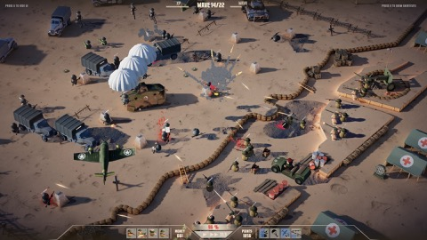
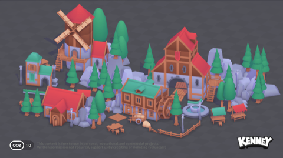
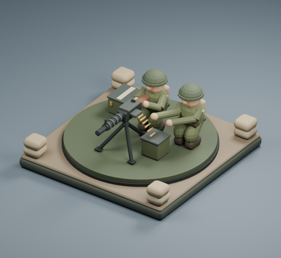
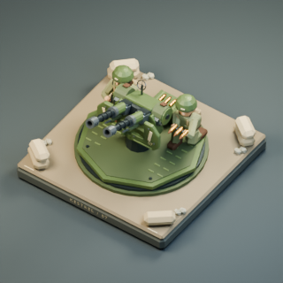

# STD-3 — Camera angles from the art and moodboard

Start with a **perspective camera, 55° downward pitch, 45° yaw relative to the square grid, and 40° vertical field of view**. This should preserve the miniature battlefield character while exposing enough ground for a mobile maze tower defense. These are proposed blockout settings, not settings recovered from the references or a validated final camera. No scene or gameplay values change in this report.

## What the references show

Reviewed the project-root `ART_PLAN.md`, all six `MoodBoard/Northend-Tower-Defense-*.jpg` images, all three `MoodBoard/kenny-*.png` images, Machine Gun Team's still/README/build script, and Kestrel's gameplay still, animation keyframes, README/build/preview scripts. Those source folders live outside this Git repository. The small review copies below keep representative evidence available in this PR; the complete original images remain in the project workspace.

| Sources | Visible camera/composition evidence | Approximate interpretation |
| --- | --- | --- |
| Northend 1, 3, 4, 5 | Broad ground coverage, visible roofs/helmets and side faces, diagonal defenses and roads, little horizon. #3's tall foreground wall and #4's parachutes show possible occlusion. | Elevated oblique tactical view; roughly 45–60° downward. |
| Northend 2 | Similar elevated coverage, with tall arches hiding ground and dense flashes/status icons competing with units. | Roughly 45–60°; height alone does not solve occlusion or effects clutter. |
| Northend 6 | More prominent unit and shield fronts, less exposed ground behind them, atmospheric depth. | Appears shallower, roughly 35–50°; appealing combat staging but more overlap risk. |
| Kenney fantasy kit, fantasy scene, castle kit | Roofs and facades are both visible; repeated modules keep a fairly consistent scale. The assembled village overlaps buildings and trees densely. | Roughly 30–45° downward; orthographic or weak-perspective appearance. Useful for form/material direction, less suitable as literal maze framing. |
| Machine Gun Team | Clear square footprint, circular aiming platform and weapon/crew silhouettes; loader and gunner overlap from this direction. | Build script explicitly uses orthographic projection; its position/target imply about 33° downward. A hero presentation, not proof of battle readability. |
| Kestrel gameplay and animation keyframes | Gameplay still exposes tile and twin barrels more clearly from above; keyframes show crew/reload poses, but their detail is small. | Build uses orthographic projection; gameplay preview position/target imply about 45° downward. The hero/rotation setup is about 41°. |

Screenshot angle ranges are **visual estimates**, plausibly uncertain by 10° or more. Northend and Kenney images do not establish exact lens settings or prove orthographic versus perspective projection. Near-parallel edges and consistent scale can also come from a distant perspective camera. Their apparent obliqueness suggests testing yaw about **30–60° relative to the dominant ground/building axes**; these are not recoverable world-space yaw values. Different object orientations prevent one exact yaw from describing every image. Pitch here means degrees below horizontal: 0° looks along the ground, 90° looks straight down. “Isometric” describes the general appearance loosely; these images do not establish a mathematically isometric camera.

*Northend Tower Defense, supplied moodboard reference 1; reduced for analysis.*

*Kenney fantasy scene, supplied CC0-labeled reference; reduced copy.*

*Existing project art: reduced Machine Gun Team still and original 320 × 320 Kestrel gameplay preview. These are asset presentations, not a captured playable battle.*

## Why this starting camera

A 55° pitch exposes bends, placement cells and enemies behind neighboring defenses better than the lower hero views. Going toward 70–90° would improve plan readability further but hide weapon/crew fronts and weaken the art's character. Going toward 30° emphasizes those faces while increasing overlap and compressing distant rows. Diagonal yaw shows two sides of the square defenses; also compare grid-aligned yaw, which may make tracing long maze corridors easier.

Mild perspective gives depth and height cues, but distant cells become smaller touch targets and near towers can dominate the screen. Orthographic keeps equally oriented ground cells the same projected size at every depth and makes framing predictable, although tilted cells remain foreshortened. It is a strong fallback if far-side placement is unreliable. Neither projection guarantees good mobile performance; visible content, effects and rendering cost still need measurement.

For the first blockout, hold pitch/yaw fixed, pan over the ground and zoom by moving toward/away from a ground focus with FOV fixed. Avoid requiring free orbit to place towers. In Unity terms, use `Quaternion.Euler(55, 45, 0)` and position the camera at `focus - rotation * Vector3.forward * distance`. Choose distance from the playable bounds and unobscured viewport, reserving space for the landscape HUD and device safe areas. Do not assume a single distance fits every map or aspect ratio.

## Relationship to the existing scene and next decision

At reviewed base `604f110`, [Main.unity](../Assets/Scenes/Main.unity) and [ProjectSetup.cs](../Assets/Editor/ProjectSetup.cs) use perspective, 60° vertical FOV, position `(0, 6, -9)` and look at the origin: approximately **33.7° downward, yaw 0°**. The proposal is steeper, diagonal and narrower in FOV. Pull back to preserve coverage when narrowing FOV; retain the scene's perspective foundation. This report does not modify the scene or the separate camera-controller work.

Compare the proposal with an orthographic camera at the same pitch, yaw and ground coverage. Test a dense maze, tallest defense, moving enemies and overlapping attacks on the smallest supported landscape viewport plus wider phone/tablet ratios. Check every bend and placement footprint, near/far touch selection, HUD-covered edges, and a full aiming rotation of both unit concepts. Keep tall scenery away from routes or test obstruction fading. Choose orthographic if perspective's distant cells remain hard to select; raise pitch before sacrificing route clarity for a more dramatic view.

Validation here is source inspection and visual review of existing images, including the reduced evidence copies. No Unity render, device interaction, performance measurement, test run or build was needed for this documentation-only investigation. The recommended settings remain provisional until that playable comparison.
