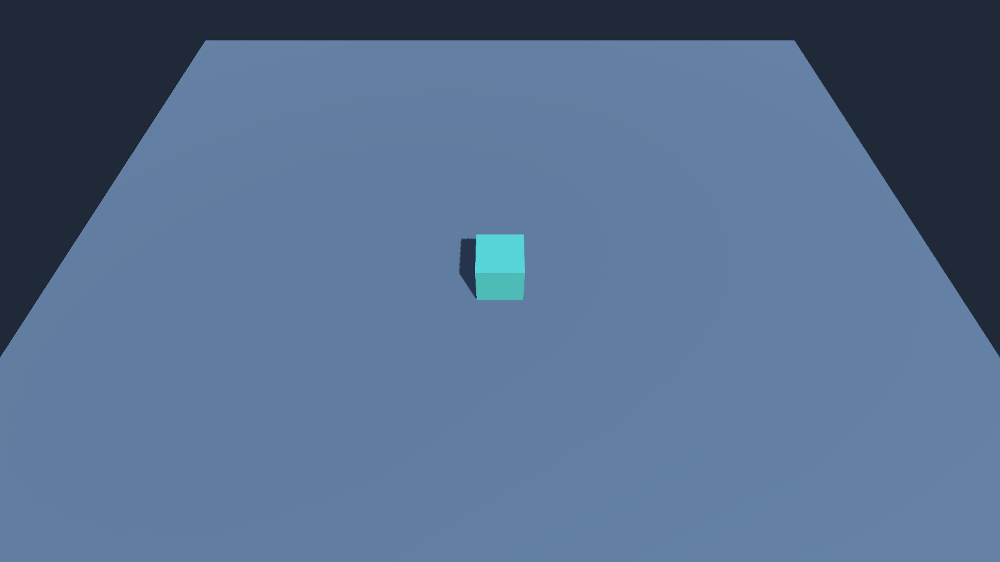
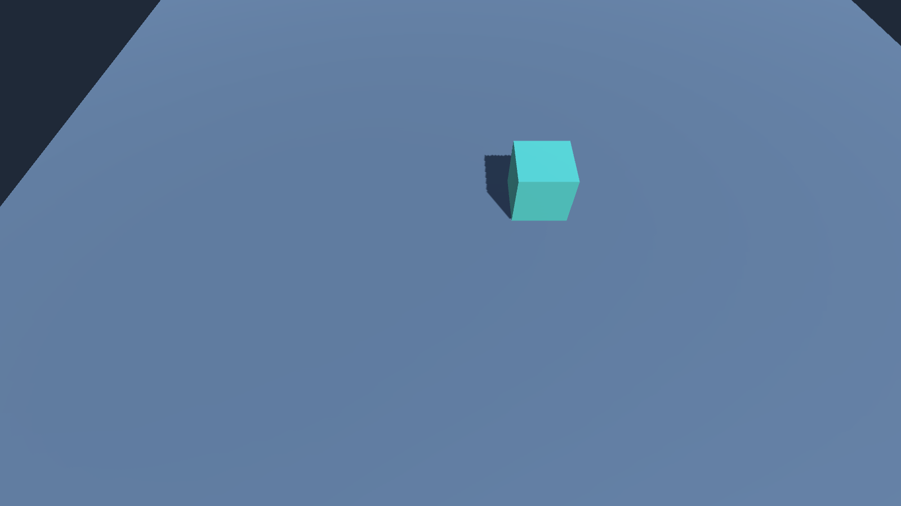
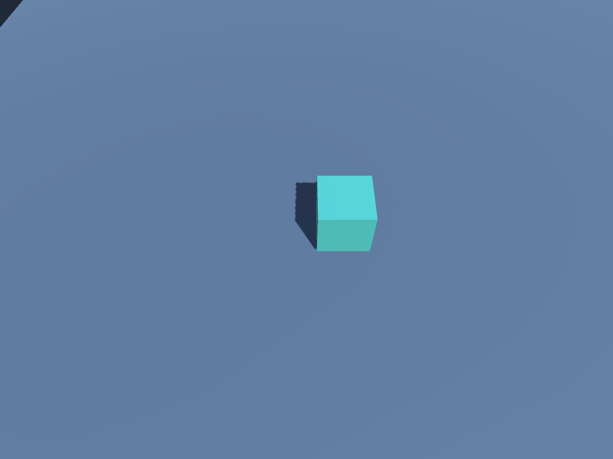

# Camera controller

`Main` now has a perspective camera controller. Drag with any mouse button to pan; use the wheel to zoom toward the cursor. On Android/iOS, drag one finger to pan and spread/pinch two fingers to zoom toward their midpoint. Moving two fingers together also pans. Touch input takes priority over Unity's synthesized mouse events.

Select **Camera Movement Bounds** in the Hierarchy. Move its Transform to reposition the allowed rectangle (including its ground height), and edit **Size** for its world-space X/Z dimensions. The yellow Scene gizmo shows the rectangle. It stays world-aligned; transform rotation and scale do not change it. Its default size is 18 × 18 around the origin.

The rectangle limits the camera's **ground focus**, where its forward ray intersects the ground plane. Viewport edges can see beyond the rectangle. It is not a physics collider. Moving/resizing it during Play also clamps an idle camera. A zero-sized rectangle locks the focus.

Select **Main Camera** to change **Minimum Distance**, **Maximum Distance**, and **Wheel Sensitivity**. Zoom moves the camera along its fixed viewing direction rather than changing perspective FOV. Distance defaults are 5–18 world units. Panning and anchored zoom stop at the rectangle edges. Bounds take priority over preserving the pointer anchor at an edge.

Pointer count/identity changes, releases/cancellations, viewport changes and focus/pause transitions rebase the gesture so a new gesture never inherits an old screen delta. With extra fingers, the lowest two active finger IDs control the gesture. The first frame after a pointer-count change establishes a fresh baseline.

The component uses the project's existing legacy Input backend (Active Input Handling: Input Manager). Attach it to a downward-looking perspective Camera and assign a Camera Movement Bounds component. The starter scene creation menu preserves this wiring.

## Camera pitch

The Main Camera uses a fixed **55° downward pitch** inspired by the Northend moodboard. Pitch is measured below horizontal: 0° is horizontal and 90° is straight down. This is a chosen starting setting, not a measured Northend specification. Yaw and roll remain 0°; perspective projection and 60° vertical FOV are unchanged. Pan and zoom retain this orientation.

The scene and starter-scene generator share this pitch. The camera still focuses on the origin at its original distance of √117 (about 10.82) world units; its initial position is approximately `(0, 8.860, -6.204)`.

## Validation

For the 55° pitch update, Unity 6000.6.7f1 passed all 51 existing camera-controller assertions and refreshed the camera screenshots below. Starter-scene validation and cube framing checks at 16:9, 19.5:9, and 4:3 also passed; README/mobile screenshots were refreshed. This update was checked with editor renders and synthetic input; mobile builds and physical device checks were not repeated.

Run **Tools > Super Tower Defense > Validate Camera Controller**, or:

```sh
Unity -batchmode -quit -projectPath "$PWD" -executeMethod CameraControllerValidation.ValidateAndCapture -logFile /tmp/std2-camera-validation.log
Unity -batchmode -quit -buildTarget Android -projectPath "$PWD" -executeMethod MobileBuild.AndroidApk -logFile /tmp/std2-android-build.log
```

The deterministic checks call the runtime gesture tracker and camera methods, including a one-to-two-to-one finger sequence, pinch direction, reordered/replaced fingers, third fingers, releases, focus reset, viewport resize, zoom anchoring/limits and panning to all four edges. They also check moved/resized/zero-sized bounds and phone/tablet render aspects. They restore the saved scene after validation.

Editor render before input:



Editor render after anchored zoom and drag:



Phone (19.5:9) and tablet (4:3) editor renders:




Recorded on Unity 6000.6.7f1. See `camera-validation.txt` for the assertion result. Android ARM64 IL2CPP APK build succeeded (116,952,560 bytes, debug signing). This is compile/build and synthetic input coverage, not physical mobile touch or performance testing. No connected mobile device was available. Interactive mouse Play-mode verification was attempted but Unity displayed its new Editor Software Terms; those were not accepted by the agent. A human must accept the terms before that manual check. iOS was not rebuilt for this ticket; the controller is platform-neutral and the existing iOS starter settings are retained.

The existing base has a `TagManager.asset` parser warning on import (bare empty layer entries); it did not prevent camera validation or Android build. No unrelated project settings were changed.
