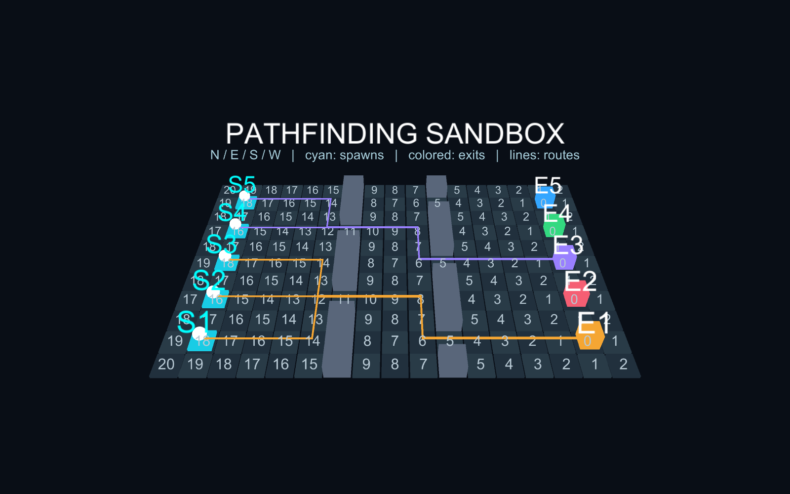

# Pathfinding sandbox

Open `Assets/Scenes/PathfindingSandbox.unity`, then press Play. The retained scene has primitive geometry and a baked preview, so it is also visible without Play mode. It is separate from Main and is not added to the build scene list.

- Run/Pause controls playback; Step advances exactly one integer simulation tick; Reset returns to tick zero.
- Next scenario cycles 1 spawn / 3 exits, 2 / 1, 5 / 5, and a disconnected layout.
- Nearest uses one reverse BFS seeded by all exits. Assigned and Subset use one field per exit, at most five. Exit IDs follow the configured array order, starting at zero internally (labels E1–E5).
- White spheres move one orthogonal tile per tick. Cyan boxes mark spawns; colored boxes mark exits. Colored lines show remaining routes. Numbers show distances for S1's permitted destinations; X means unreachable. Other agents can have different permissions.
- Assigned uses the next exit ID cyclically; Subset permits the agent's exit ID and the ID two places later, cyclically. These fixed demo policies make runs repeatable and demonstrate restricted targets.

`PathfindingSimulation.AdvanceTick()` contains all simulation changes and uses integers. The MonoBehaviour's elapsed-time accumulator only determines playback speed; no ticks are discarded when the render loop falls behind. Reset/scenario/policy buttons start a new simulation. No random numbers, threads, physics navigation, or Transform reads participate in route calculation. Agents intentionally share tiles: avoidance, waves, combat, and production tower-placement validation are outside this sandbox.

`ReverseBfsField` uses a FIFO queue, stable N/E/S/W neighbors and ascending exit IDs. Equal-distance goals select the lowest stable exit ID. A route step decreases distance by one; at the destination it stays put. Blocked/disconnected starts return no route and stay still. Invalid/duplicate/blocked endpoints and invalid masks are rejected. Walkability changes invalidate existing fields and queries fail until rebuilt. Search assumes unit-cost reciprocal edges; directed or weighted grids require a different traversal contract/algorithm.

Fields are built synchronously at simulation creation, then shared by every marker. Rebuild reuses its arrays; ordinary routing and integer ticks allocate no memory. This prototype stores four integer arrays per field (distance, next node, goal ID, queue), approximately `16 * tileCount * fieldCount` bytes excluding object/array headers and grid data. Primitive meshes, text and GUI are debug visualization rather than a mobile rendering design. No device performance claim is made.

## Validation

Use **Tools > Super Tower Defense > Validate Pathfinding** or:

```sh
Unity -batchmode -nographics -quit -projectPath "$PWD" -executeMethod PathfindingValidation.Run -logFile /tmp/pathfinding-validation.log
```

Checks compare reverse BFS against independent forward BFS across all 512 walkability masks on a 3×3 grid. They also cover multi-goal minima, tie order, assigned/subset permissions, stale fields, invalid inputs, disconnected agents, and deterministic tick-by-tick replays of every scenario/policy combination, including cardinal movement and eventual allowed arrivals.

**Tools > Super Tower Defense > Create Pathfinding Sandbox** explicitly rebuilds the sandbox scene and materials. `PathfindingSandboxSetup.CreateAndValidate` also runs the checks and captures the default scene to `Documentation/pathfinding-sandbox.png`; graphics must be enabled for capture. The scene is retained for future algorithm work. Inspector scenario/policy changes take effect on the next Play session; Play-mode buttons reset immediately.



Play-mode integration can be checked with `-batchmode -executeMethod PathfindingPlayValidation.Begin` (omit `-quit`; the checker exits Unity itself). It verifies paused startup, 80 explicit ticks against a reference simulation, visible marker positions, and reset.
