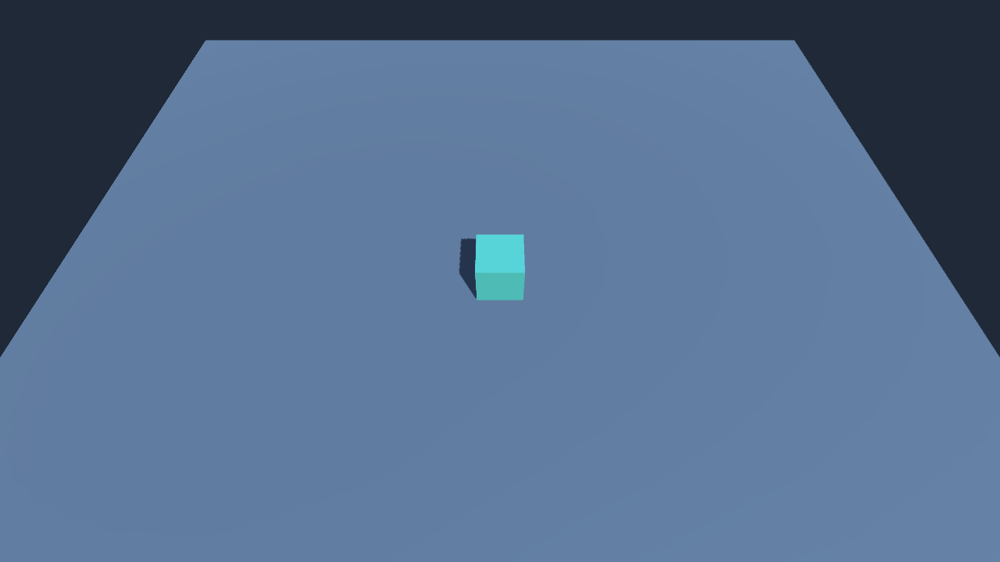
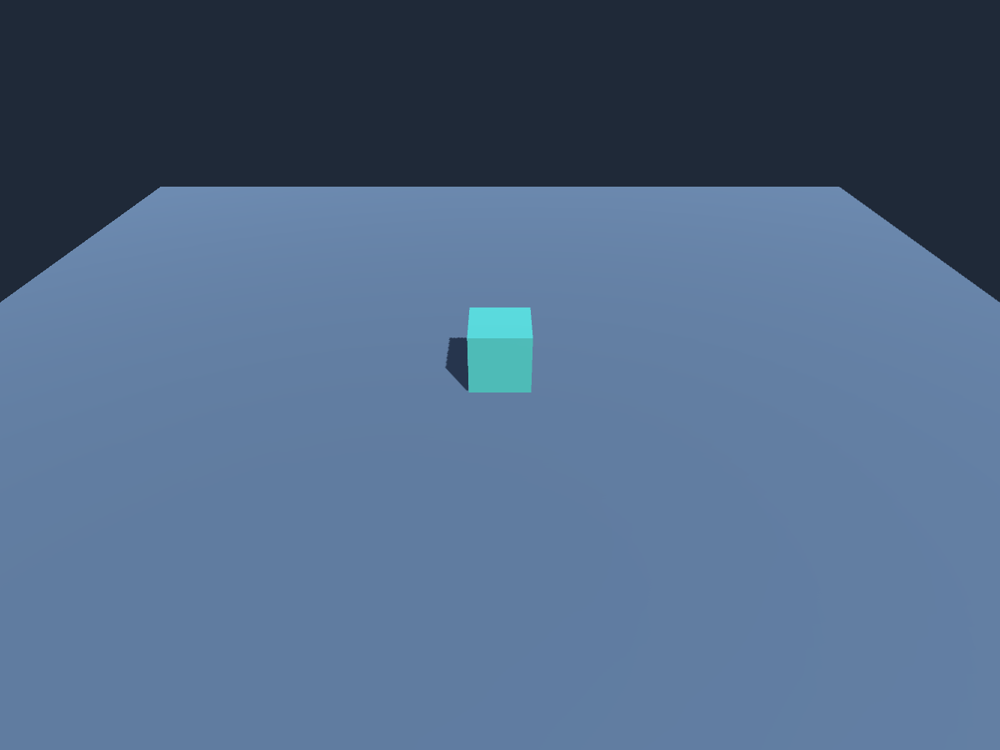

# Super Tower Defense

Unity 3D starter project using Unity **6000.6.7f1** and the built-in render pipeline.

Open this repository folder in Unity Hub with the version in `ProjectSettings/ProjectVersion.txt`, then open `Assets/Scenes/Main.unity` and press Play. The scene contains a perspective Main Camera (60° field of view), audio listener, directional light, ground plane and starter cube. `Main` is the enabled build scene. No gameplay is implemented yet.

The cube and plane provide a simple 3D reference for future work. Recreate the scene with **Tools > Super Tower Defense > Create Starter Scene**. This replaces the current scene; save any scene work first.

Drag with a mouse button or one finger to pan. Use the mouse wheel or a two-finger pinch to zoom. Move/resize **Camera Movement Bounds** to set the allowed ground-focus rectangle; tune zoom limits on **Main Camera**. See [camera controls, bounds and validation](Documentation/camera-controller.md).

Validation can also run from the command line:

```sh
Unity -batchmode -quit -projectPath "$PWD" -executeMethod ProjectSetup.CaptureAndValidate -logFile /tmp/std1-validation.log
```

The command verifies the camera, light and build scene and renders `Documentation/starter-scene.png`.



## Mobile starter

Android and iOS use `com.selimabidin.supertowerdefense`, IL2CPP, and landscape autorotation (left/right). Android targets ARM64, minimum API 26, the installed SDK's latest target API, and OpenGL ES 3 for a conservative built-in renderer baseline. iOS targets iPhone/iPad, iOS 15+, and Metal. The mobile Medium quality tier uses one pixel light, hard shadows within 20 units, 2× MSAA, and no soft particles or realtime reflection probes. These are starter defaults; profile on target hardware before expanding the scene. Package ID and signing must be confirmed before store publication.

Install **Android Build Support**, its **SDK & NDK Tools** and **OpenJDK**, plus **iOS Build Support**, for this editor in Unity Hub. Use the saved settings directly; **Tools > Super Tower Defense > Configure Mobile** reapplies them.

```sh
# Replace Unity with the editor executable. Run from the project root.
Unity -batchmode -quit -projectPath "$PWD" -executeMethod MobileBuild.CaptureAndValidate -logFile /tmp/mobile-aspects.log
Unity -batchmode -quit -buildTarget Android -projectPath "$PWD" -executeMethod MobileBuild.AndroidApk -logFile /tmp/mobile-android.log
Unity -batchmode -quit -buildTarget iOS -projectPath "$PWD" -executeMethod MobileBuild.IosProject -logFile /tmp/mobile-ios.log
```

The Android command creates a local debug-signed APK at `Builds/Android/SuperTowerDefense.apk`; release keystore credentials are intentionally unset. For Google Play, enable App Bundle in Build Profiles and supply release signing. The iOS command exports `Builds/iOS`; compiling, signing and installing it requires full Xcode and an appropriate Apple provisioning setup.

Aspect validation checks all eight cube bounds corners and captures 16:9, 19.5:9 phone and 4:3 tablet landscape editor renders. These images verify camera framing, not device performance, safe-area UI, touch input, or mobile GPU output. The starter has no UI or gameplay to exercise yet.




See [the recorded build validation and remaining device checks](Documentation/mobile-validation.md).

## Navigation grid

`SquareNavigationGrid` stores walkability and integer node IDs (`x + y * width`). Neighbors use a stable north/east/south/west order without diagonals or row wrapping. Search code can depend on `INavigationGrid` rather than Unity objects. `Revision` changes only when walkability changes.

Run **Tools > Super Tower Defense > Validate Navigation Grid** or use `-batchmode -quit -executeMethod GridValidation.Run`.

## Pathfinding sandbox

Open `Assets/Scenes/PathfindingSandbox.unity` for the retained main-thread BFS test scene. Use Run, Pause, Step, Reset, scenario selection and nearest/assigned/subset policies. See [controls, algorithm behavior and validation](Documentation/pathfinding-sandbox.md).
